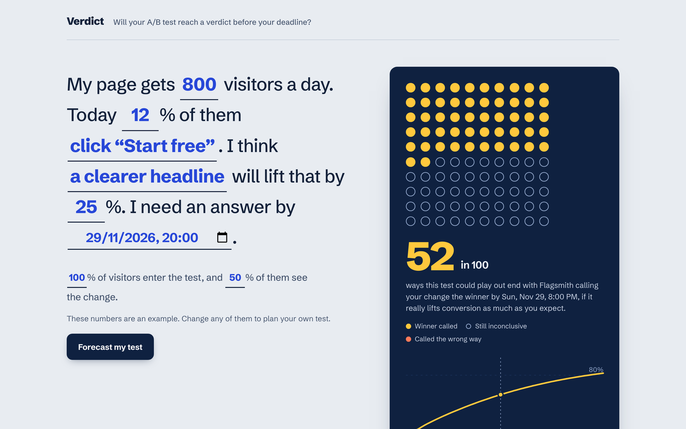
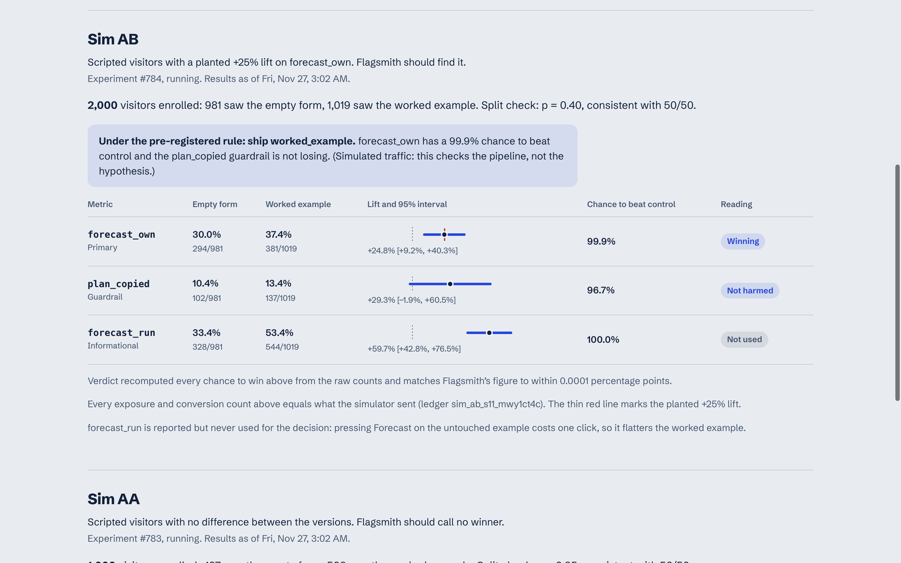
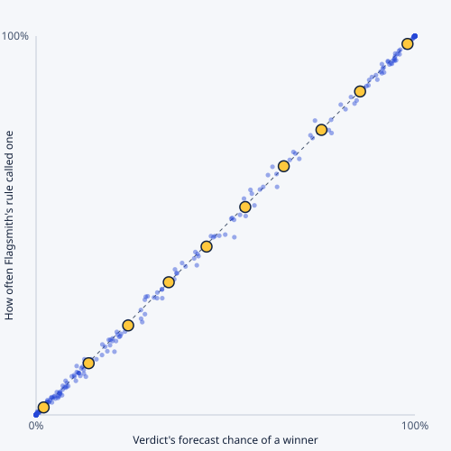
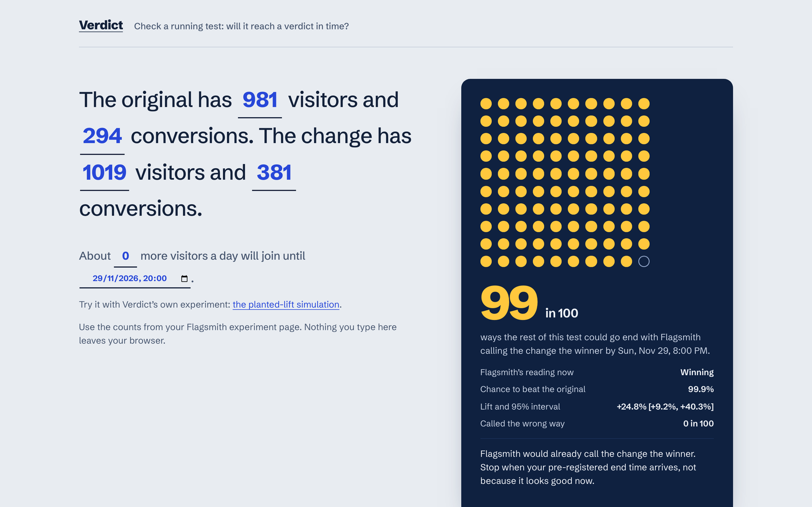
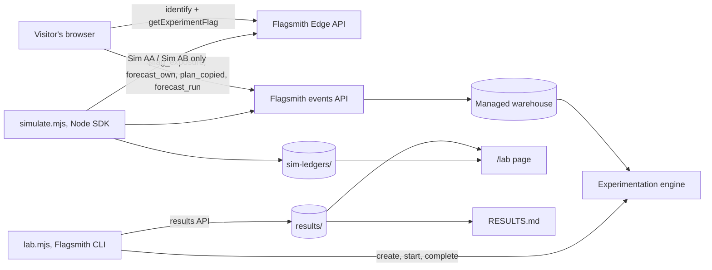

# Verdict

[](https://github.com/r69shabh/verdict/actions/workflows/ci.yml)

**Will your A/B test reach a verdict before your deadline?** Verdict forecasts the chance that Flagsmith
Experimentation calls a winner in time, then hands you a pre-registration and the Flagsmith CLI commands to
run the test. And it runs a real Flagsmith experiment on its own first screen.

**Live:** https://verdict.rishabhgusain-6.workers.dev ·
**Results so far:** [/lab](https://verdict.rishabhgusain-6.workers.dev/lab) ·
**Check a running test:** [/check](https://verdict.rishabhgusain-6.workers.dev/check) ·
**Pre-registration:** [EXPERIMENT.md](EXPERIMENT.md) · **Results:** [RESULTS.md](RESULTS.md) · **Run log:** [RUNLOG.md](RUNLOG.md)

Built for [Toggle Wars](https://www.wemakedevs.org/hackathons/flagsmith), Track 01: Test Something Real.



## In two minutes

- **The question.** Verdict's first screen is a sentence with blanks. Does filling them with a worked example get
  more visitors to forecast **their own** test than leaving them empty? One multivariate flag, `first_screen`.
- **Planned first.** Hypothesis, metrics, power and decision rule were committed in [EXPERIMENT.md](EXPERIMENT.md)
  before the experiment started. Every later change is a dated amendment, and every action is in [RUNLOG.md](RUNLOG.md).
- **A metric that cannot be gamed.** The primary metric, `forecast_own`, only counts forecasts with the visitor's own
  numbers. The obvious metric, "pressed Forecast", is tracked too, and the simulation shows it flatters the example by
  +60% because pressing Forecast on the untouched example costs one click.
- **The pipeline is proven before it is trusted.** An A/A simulation shows no false winner. A planted +25% lift is
  recovered (+24.8%, 95% interval +9.2% to +40.3%). Every exposure and conversion Flagsmith counted equals the
  simulator's ledger exactly.
- **Verdict's maths is Flagsmith's maths.** Verdict reproduces Flagsmith's reported lift, interval and chance to win
  from raw counts to 9 decimal places, so its forecasts use the statistic Flagsmith actually applies.
- **The winner ships through the same flag.** Completing the experiment with a rollout decision
  (`pnpm lab complete`) sets every visitor to the chosen version.

## The experiment

| | |
|---|---|
| Flag | `first_screen`: `control` (empty form) vs `worked_example` (pre-filled) |
| Primary metric | `forecast_own`: a forecast shown for numbers that are not the untouched example (occurrence, increase) |
| Guardrail | `plan_copied`: copied the pre-registration, CLI commands or instrumentation code (should not decrease) |
| Informational | `forecast_run`: any forecast, which the worked example inflates by design |
| Split | 100% of visitors, 50/50, bucketed on a random visitor ID |
| Decision rule | ship at a 95% chance to beat control with no sample ratio mismatch and a guardrail that is not losing; keep control at 5% or below; otherwise inconclusive, keep control |

Three Flagsmith environments keep real and scripted traffic apart:

| Environment | Traffic | What it shows |
|---|---|---|
| Production | real visitors only | the answer to the question |
| Sim AA | 1,000 scripted visitors, no difference | Flagsmith calls no winner (47.9%), split is clean (p = 0.85) |
| Sim AB | 2,000 scripted visitors, planted +25% | Flagsmith finds it: +24.8% [+9.2%, +40.3%], 99.9% chance to win |

The decision rule is code ([src/decision.ts](src/decision.ts)): [/lab](https://verdict.rishabhgusain-6.workers.dev/lab)
and [RESULTS.md](RESULTS.md) both apply it to Flagsmith's own numbers.



## How Flagsmith is used

| Flagsmith | Where | What it does here |
|---|---|---|
| Multivariate flag | `first_screen` | serves the two versions of the first screen |
| JS SDK `getExperimentFlag` | [src/experiment.ts](src/experiment.ts) | evaluates the flag and records the exposure at the moment the form renders |
| JS SDK `trackEvent` | [src/experiment.ts](src/experiment.ts) | sends `forecast_own`, `forecast_run`, `plan_copied` for enrolled visitors; flushes immediately with `keepalive` so a conversion right before closing the tab arrives |
| Experimentation | 3 metrics, 3 experiments | occurrence metrics with goal and guardrail directions, one experiment per environment |
| Managed warehouse | each environment | stores exposures and events |
| Results API | [scripts/lab.mjs](scripts/lab.mjs) | snapshots results, exposures and excluded identities into [results/](results/) |
| CLI v2 | [scripts/lab.mjs](scripts/lab.mjs) | creates the flag, variant, metrics and experiments, starts them, and completes them with a rollout decision |
| Node SDK | [scripts/simulate.mjs](scripts/simulate.mjs) | drives the seeded simulations through the same exposure and event path |

Verdict also gives visitors the same Flagsmith workflow: its plan output is a pre-registration, CLI commands (flag,
keyed variant, metric, experiment, start) that were run for real against Flagsmith before shipping, and SDK code
for the exposure and the conversion in four languages, syntax-checked in tests.

## What building this taught me about Flagsmith's statistics

Flagsmith's results API returns, for each variant, `n`, `sum` and `sum_squares`, plus a lift, a 95% interval and a
chance to win. Those numbers are reproduced exactly by a delta-method normal approximation on the relative lift,
using each arm's sample variance (n − 1):

```
lift = m₁/m₀ − 1     se = √( v₁/m₀² + (m₁/m₀)²·v₀/m₀² )     interval = lift ± 1.96·se     chance to win = Φ(lift / se)
```

[src/stats.test.ts](src/stats.test.ts) checks this against Flagsmith's own output for three metrics to 9 decimal
places. It matters for planning: in absolute terms the statistic is (p₁ − p₀)/√(v₁ + (p₁/p₀)²·v₀), so the control's
variance is inflated by the lift, and because the standard error is estimated from the same counts the statistic is
skewed. For a 30% → 36% test, a textbook difference-of-rates formula says 1,512 visitors for an 80% chance; under
Flagsmith's rule it takes **1,647**, and with no real effect the rule calls a false winner about 4% of the time
rather than 5%. Verdict's forecast integrates the statistic's actual distribution, including the 5-conversion floor.

**Is "60 in 100" really 60 in 100?** A [calibration study](docs/CALIBRATION.md) of 300 random test plans, each
simulated 1,000 times under Flagsmith's exact rule, puts Verdict's forecasts within **0.6 percentage points** on
average. The first version of the forecast used a normal approximation and was off by 5 points at the extremes;
the study found that, and the integral replaced it.



Other things I found while building, with evidence, are in [docs/FLAGSMITH-NOTES.md](docs/FLAGSMITH-NOTES.md):
a `null` sample ratio check, the false-winner cost of peeking, and browser events lost on tab close without
`keepalive`.

## The tools

**Plan** (`/`). Fill in traffic, today's rate, the lift you expect and your deadline. Each of 100 dots is one way
the test could play out. You also get when Flagsmith will show its first numbers, when an 80% chance arrives, the
smallest lift your traffic can catch in time, the false-winner cost of checking daily, and a pre-registration,
CLI commands and instrumentation code for JavaScript, React, Python or Node.js.

**Check** (`/check`). Enter the counts from a running experiment. Verdict shows the reading Flagsmith would give
now, then simulates the visitors still to come from plausible true rates and applies Flagsmith's rule at your
deadline: how likely the test is to finish with a winner, and what to do about it.



**Lab** (`/lab`). Verdict's own experiment: every environment, every metric, the interval drawn against zero, the
pre-registered call, and whether Flagsmith's counts match the simulator ledger.

## Architecture



Verdict is a static React app served from Cloudflare Workers static assets, with no backend and no database. The
Production client-side key is public by design; admin credentials stay in the CLI's OS keychain.

## Verification

| Check | Command | What it covers |
|---|---|---|
| Unit tests (54) | `pnpm test` | forecast maths vs Monte Carlo of Flagsmith's rule, Flagsmith fixtures, parsing, decision rule, interim check, CLI output run through bash with a stub that proves visitor text never executes |
| End-to-end (9) | `pnpm build && pnpm e2e` | headless Chrome over both arms, 9 worst-case inputs at 1280 and 390 px (no NaN, no overflow, no script errors), `/lab`, `/check`, axe-core accessibility, and a check that preview mode never contacts Flagsmith |
| CI | GitHub Actions | typecheck, unit tests, build and e2e on every push |
| Live CLI | logged in [RUNLOG.md](RUNLOG.md) | the generated commands created a real flag, metric and experiment in a scratch environment, then were cleaned up |
| Ledger | `pnpm lab verify` | Flagsmith's counts equal what the simulator sent |
| Calibration | `node scripts/calibrate.mjs` | 300 random plans × 1,000 simulations: forecast vs Flagsmith's rule, mean error 0.6 points |

## Run it

Requires Node 22 and pnpm 12.

```sh
pnpm install --frozen-lockfile
pnpm dev                                   # no key: empty form, nothing counted
pnpm test && pnpm build && pnpm e2e
```

Preview either version without recording anything: `/?preview=control` or `/?preview=worked_example`.

### Set up the experiment in your own Flagsmith project

```sh
brew install Flagsmith/tap/flagsmith       # CLI v2
flagsmith login
pnpm lab envs                              # environments, warehouse and experiment status
pnpm lab warehouse --env Production        # managed warehouse (repeat per environment)
pnpm lab flag                              # first_screen + worked_example variant
pnpm lab setup --env Production            # metrics + experiment, not started
pnpm lab start --env Production
echo "VITE_FLAGSMITH_ENVIRONMENT_KEY=<client-side key>" > .env.production.local
pnpm ship                                  # build + wrangler deploy
```

### Simulate, snapshot, decide

```sh
node scripts/simulate.mjs --mode ab --dry-run                         # see the planted model
FLAGSMITH_SIM_ENVIRONMENT_KEY=<Sim AB key> node scripts/simulate.mjs --mode ab --yes
pnpm lab verify --env "Sim AB" --ledger sim-ledgers/<run>.json
pnpm release                               # snapshot all environments, write RESULTS.md, deploy /lab
pnpm lab complete --env "Sim AB" --decision variant --yes             # ship the winner through the flag
```

## Limitations

- Real traffic over a three-day hackathon is small. The pre-registration says so: at a few hundred visitors the
  Production result is likely to be inconclusive, and an honest inconclusive is the expected outcome, not a failure.
- Simulated results validate the instrumentation and the analysis, not the hypothesis.
- Verdict's forecast assumes your expected lift is the true lift and traffic is steady; it is a planning aid.

## Privacy

No accounts and no personal data. Each browser gets a random ID (`v_<uuid>`) used only to keep the same version
across visits and to join exposures with events in Flagsmith. Automated browsers are not enrolled.

## Licence

MIT
