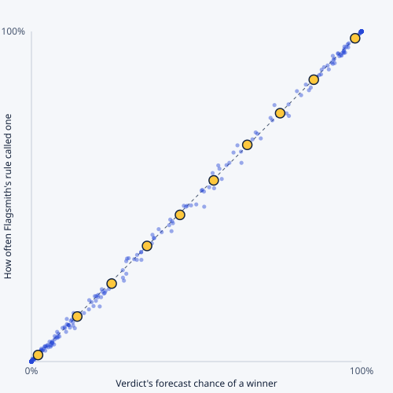

# Calibration

Is "60 in 100" really 60 in 100? `node scripts/calibrate.mjs 300 1000` draws 300 random test plans
(baseline 2–50%, lift 5–60%, 30–5,000 visitors a day, half a day to a week, split 30–70%), asks Verdict for the
chance of a winner by the deadline, then simulates each plan 1,000 times and applies Flagsmith's exact
rule to the simulated counts: no result until every arm has 50 visitors and 5 conversions, then a winner at a 95%
chance to beat control computed the way Flagsmith computes it ([src/stats.ts](../src/stats.ts), which reproduces
Flagsmith's results API to 9 decimal places).

Blue dots are plans; yellow dots are the averages per 10% band of the forecast. On the dashed line, the forecast
is exactly right.

- Mean absolute difference between forecast and simulated frequency: **0.6 percentage points**.
- Plans forecast within 5 points: **100%**. Each simulated frequency has its own Monte Carlo error of up to
  1.6 points.

| Forecast band | Plans | Mean forecast | How often Flagsmith's rule called a winner |
|---|---|---|---|
| 0–10% | 102 | 2.0% | 2.0% |
| 10–20% | 26 | 13.9% | 13.6% |
| 20–30% | 19 | 24.3% | 23.6% |
| 30–40% | 13 | 35.0% | 35.0% |
| 40–50% | 10 | 45.0% | 44.4% |
| 50–60% | 13 | 55.2% | 54.9% |
| 60–70% | 10 | 65.4% | 65.6% |
| 70–80% | 7 | 75.3% | 75.2% |
| 80–90% | 13 | 85.5% | 85.4% |
| 90–100% | 87 | 98.0% | 97.9% |

## What this study changed

The first version of the forecast treated Flagsmith's statistic as normally distributed. This study showed it was
too cautious at the extremes: plans it put at 15% actually won about 5% of the time, and plans at 85% won about 92%
(mean error 5.0 points). The cause is that Flagsmith's standard error is estimated from the same counts, so a high
observed variant rate also widens the interval and the statistic is skewed. The forecast now integrates the
statistic's actual distribution, solving for the variant rate at which it crosses the threshold for each plausible
control rate, and applies the 5-conversion floor to the observed counts. That brought the mean error to the level
of the Monte Carlo noise.
